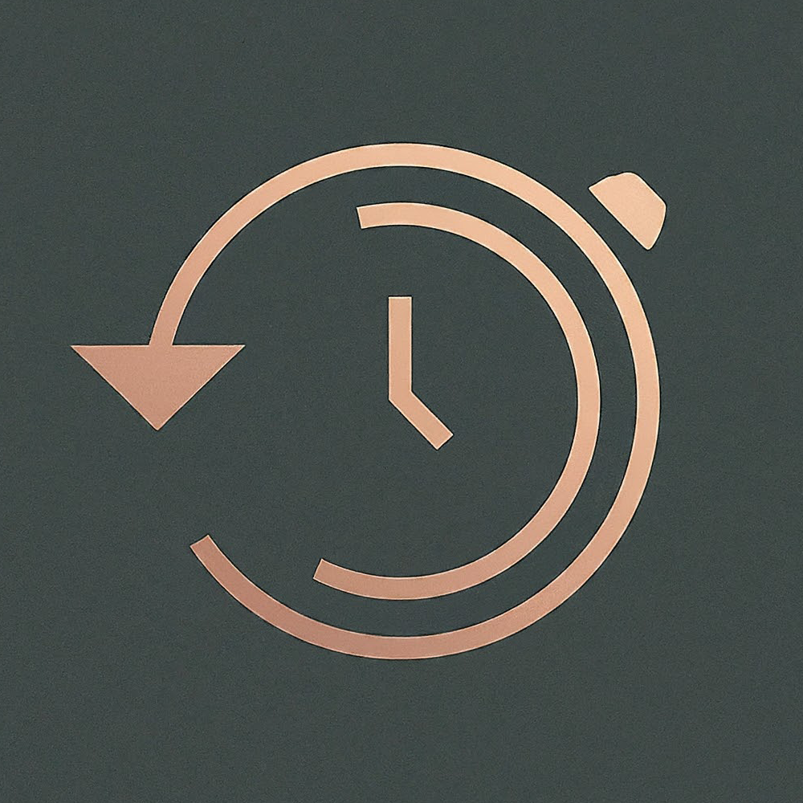
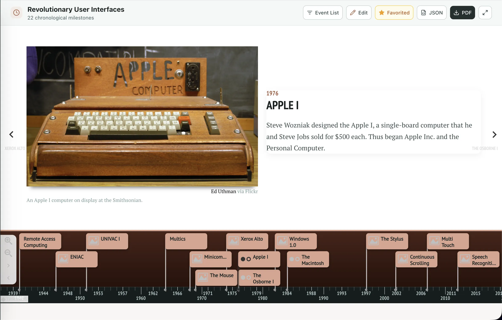
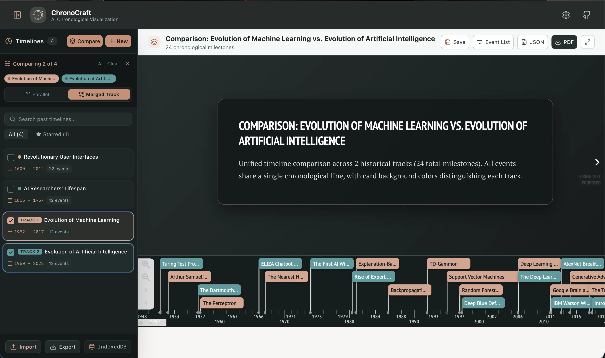

<br />
<div align="center">

  
  <br/>
  <br/>
  
  <h3 align="center">ChronoCraft</h3>
  <p align="center">
    Timeline Research Tool | Crafting Data into Stories, One Timeline at a Time
    <br />
    <a href="https://chronocraft.wiki"><strong>chronocraft.wiki</strong></a>
    <br />
    <a href="https://github.com/hmolavi/ChronoCraft">OG Hackathon Version [GitHub]</a>
  </p>
</div>

---

## ℹ️ What is ChronoCraft

**ChronoCraft** is an AI-powered chronological visualization platform that transforms historical inquiries, biographies, and scientific milestones into interactive, rich visual timelines. Powered by **Google Gemini** with structured schema generation (or alternative **OpenAI API** if provided) and rendered with **Knight Lab TimelineJS**, ChronoCraft makes exploring history intuitive, engaging, and accessible.

---

## 🚀 Quick Start

### Run Locally

```bash
# Clone the repository
git clone https://github.com/mamin-mojtahed/ChronoCraft.git
cd ChronoCraft/frontend

# Install dependencies
npm install

# (Optional) Pre-configure your Gemini API key
cp .env.example .env.local

# Start development server
npm run dev
```

Open [http://localhost:3000](http://localhost:3000) in your browser. 

> **API Key**: You can enter a free [Google Gemini API Key](https://aistudio.google.com/app/apikey) directly in the app via the **Settings (⚙️)** modal, or supply it in `.env.local`. Keys are stored locally in your browser.

---

## ⚙️ Features

- ⚡ **AI-Powered Chronologies**: High-accuracy structured event generation using **Google Gemini** with JSON schema enforcement, plus support for **OpenAI**.
- 📊 **Knight Lab TimelineJS**: Smooth panning, zooming, date navigation, and rich media embeds (images, YouTube, Wikipedia, Flickr).
- 💾 **Local Offline History**: Generated timelines are cached locally in your browser's **IndexedDB**, allowing you to revisit and star past timelines instantly with zero latency and zero repeated API costs.
- 🔒 **Private & Flexible**: Supports server-provided API keys on hosted instances as well as client-side Bring-Your-Own-Key (BYOK) saved strictly in your browser.
- 📸 **Export & Share**: Download timelines as JSON datasets or capture high-resolution image snapshots.

---

## 🛠️ Built With

- **Framework**: [Next.js 14](https://nextjs.org/) (App Router)
- **UI & Styling**: [React 18](https://react.dev/), [TypeScript](https://www.typescriptlang.org/), [Tailwind CSS](https://tailwindcss.com/), [Lucide Icons](https://lucide.dev/)
- **AI Models**: [Google Gemini API](https://ai.google.dev/) & [OpenAI API](https://platform.openai.com/)
- **Visualization**: [Knight Lab TimelineJS](https://timeline.knightlab.com/)
- **Storage**: Browser IndexedDB (`idb`) & LocalStorage
- **Deployment**: [Vercel](https://vercel.com/) (with optional static export fallback)

---

## 💡 Inspiration

The core inspiration was the ["Timeline of Poets & Scientists" infographic Instagram post](https://www.instagram.com/p/C636c9PgOZM) designed by [Mohammad Rasoulipour](https://www.instagram.com/mo.rasoulipour/) that Amin shared with the group. This inspired us to build a history visualization tool that tackles the challenge of identifying, analyzing, and illustrating chronological data with intuitive storytelling.

---

## 🖼️ Demo





---

## 👨‍💻 Team

- **Project Revival**
  - **Amin Mojtahed** [[GitHub]](https://github.com/mamin-mojtahed) [[LinkedIn]](https://www.linkedin.com/in/mamin-mojtahed/)
- **Rest of OG Hackathon Team**
  - **Hossein Molavi** [[GitHub]](https://github.com/hmolavi) [[LinkedIn]](https://www.linkedin.com/in/hmolavi/)
  - **Beomsoo Son** [[GitHub]](https://github.com/k1a11220) [[LinkedIn]](https://www.linkedin.com/in/beomsoo/)
  - **Abtin Abbaspour** [[GitHub]](https://github.com/abtin-abbaspour) [[LinkedIn]](https://www.linkedin.com/in/abtin-abbaspour/)
