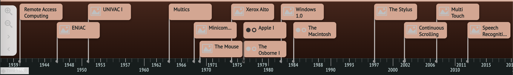

<br />
<div align="center">

  
  <br/>
  <br/>
  
  <h3 align="center">ChronoCraft</h3>
  <p align="center">
    Crafting Data into Stories, One Timeline at a Time
    <br />
    <a href="https://youtu.be/CsF0szB0zlw">Demo [YT Video]</a>
    <br />
    <a href="https://taikai.network/hackbox/hackathons/hawkhacks/projects/clwczw3d10ckuz901uiepeat7/idea">Hackathon Post [TaiKai]</a>
  </p>
</div>

---

## ☝️ What is ChronoCraft ☝️

ChronoCraft is an innovative timeline visualization application that transforms historical inquiries and chronological topics into interactive, captivating visual narratives. Powered directly by **Google Gemini AI** (with structured schema generation) and rendered via **Knight Lab TimelineJS**, ChronoCraft enables researchers, students, educators, and history buffs to explore the flow of time seamlessly.

The application runs as a **100% static, client-side web application** deployable on **GitHub Pages**. All retrieved timelines and queries are cached locally in your browser's **IndexedDB**, allowing you to revisit and re-display past timelines on-demand from the sidebar with zero latency and zero repeated API costs.

## 💡 Inspiration 💡

The resource that became our core inspiration was the ["Timeline of Poets & Scientists" infographic Instagram post](https://www.instagram.com/p/C636c9PgOZM) designed by [Mohammad Rasoulipour](https://www.instagram.com/mo.rasoulipour/) that Amin shared with the group. This inspired us to work on a history visualization project where ChronoCraft tackles the challenge of identifying, analyzing, and illustrating chronological data with intuitive, accessible storytelling.

## ⚙️ Features ⚙️

- ⚡ **Google Gemini AI Powered**: Queries Google Gemini with strict JSON schema enforcement to generate historically accurate, structured event chronologies with dates, headlines, and descriptions.
- 🔀 **Pluggable LLM Architecture**: Built-in support for Google Gemini as default, with immediate option to switch to OpenAI (`gpt-4o` / `gpt-4o-mini`).
- 💾 **Browser-Native Caching (IndexedDB)**: Every generated timeline is automatically saved in your browser's local cache.
- 📂 **Interactive History Sidebar**: Re-display any past query instantly from the sidebar with one click without re-querying the API. Filter and star your favorite timelines.
- 🌐 **100% Serverless & Static**: Deployed directly via GitHub Pages with automated CI/CD and custom domain support.
- 🔒 **Private & Secure**: API keys are saved exclusively in your browser's local storage and are never sent to intermediate servers.
- 📊 **Knight Lab TimelineJS Visualization**: Smooth zoom, panning, media embed support, and chronological navigation.
- 📸 **Export & Sharing**: Download timelines as JSON or high-resolution images.

## 🛠️ Built With 🛠️

- **Framework**: [Next.js](https://nextjs.org/) (Static Export)
- **UI & Styling**: [React](https://react.dev/), [Tailwind CSS](https://tailwindcss.com/), [Lucide React](https://lucide.dev/)
- **AI Engines**: [Google Gemini API](https://ai.google.dev/) (Primary with JSON Schema) & [OpenAI API](https://platform.openai.com/)
- **Timeline Engine**: [Knight Lab TimelineJS](https://timeline.knightlab.com/)
- **Storage Layer**: Browser-native IndexedDB & LocalStorage
- **Deployment**: [GitHub Pages](https://pages.github.com/) via GitHub Actions

---

## 🚀 Getting Started Locally

### Prerequisites
- Node.js 18+ or 20+
- A [Google Gemini API Key](https://aistudio.google.com/app/apikey) (free) or OpenAI API Key

### Environment Configuration

You can pre-configure your API key in an environment file so queries work immediately without entering keys into the UI:

```bash
# In the frontend directory:
cp .env.example .env.local

# Edit .env.local and insert your Gemini API Key:
# NEXT_PUBLIC_GEMINI_API_KEY=your_actual_key_here
```

### Installation

```bash
# Clone the repository
git clone https://github.com/mamin-mojtahed/ChronoCraft.git
cd ChronoCraft

# Install frontend dependencies
cd frontend
npm install

# Start local development server
npm run dev
```

Open [http://localhost:3000](http://localhost:3000) with your browser.

If you haven't set `NEXT_PUBLIC_GEMINI_API_KEY` in `.env.local`, you can also click on **Settings (gear icon)** in the top navigation bar to input your key directly into the browser's secure local storage. Once entered, search for any topic to generate your timeline!

---

## 📦 Building for GitHub Pages

To build the static production export:

```bash
cd frontend
npm run build
```

This compiles static assets into `frontend/out/`, ready for any static host or GitHub Pages.

---

## 💙 About the Team 💙

- **Hossein Molavi** [[Devpost]](https://devpost.com/Thehoos) [[LinkedIn]](https://www.linkedin.com/in/hmolavi/)
- **Amin Mojtahed** [[Devpost]](https://devpost.com/mamin-mojtahed) [[LinkedIn]](https://www.linkedin.com/in/mamin-mojtahed/)
- **Beomsoo Son** [[LinkedIn]](https://www.linkedin.com/in/beomsoo/)
- **Abtin Abbaspour** [[LinkedIn]](https://www.linkedin.com/in/abtin-abbaspour/)
